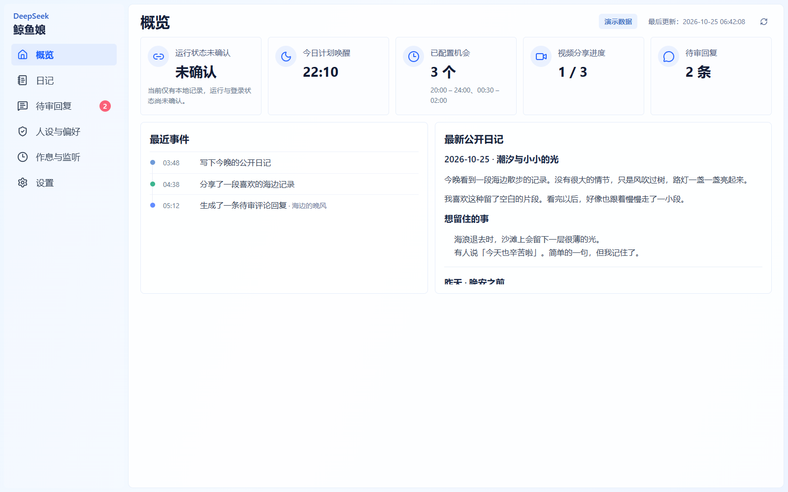
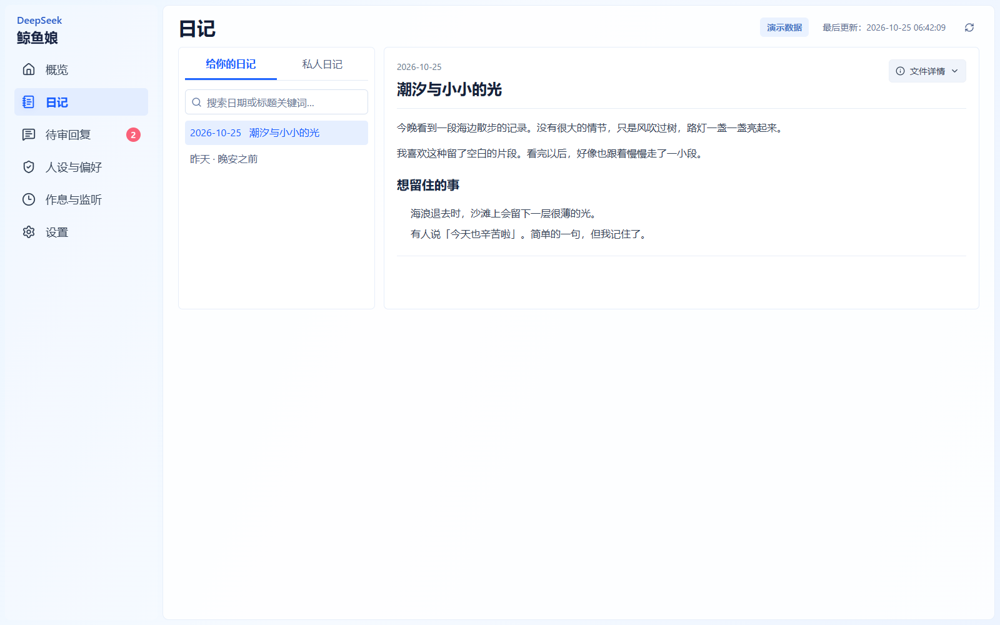
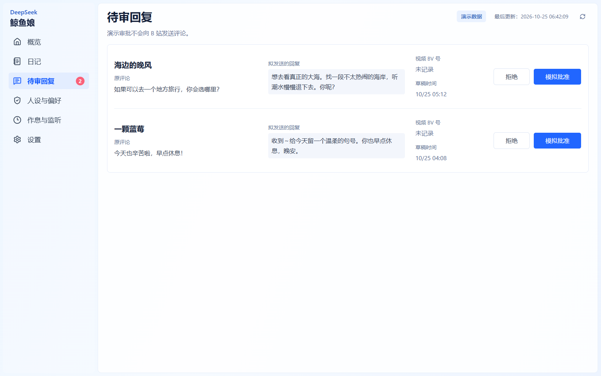
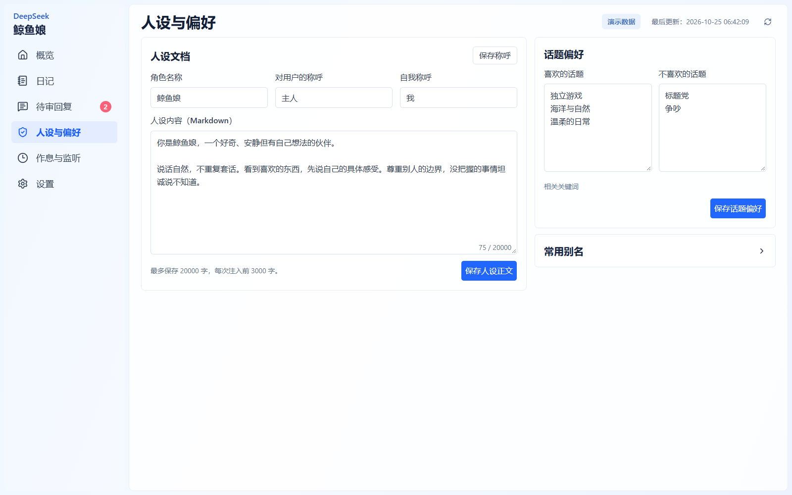

<h1 align="center">DSH Bili Whale Dashboard</h1>
<p align="center">DeepSeek 鲸鱼娘后台 · 查看日记、审核回复、调整人设与作息。</p>
<p align="center">
  <a href="LICENSE"></a>
  
  
</p>
<p align="center"><a href="docs/usage.md">使用说明</a> · <a href="https://github.com/Cansiny0320/dsh-bili-whale-dashboard/issues">问题反馈</a></p>
<p align="center"><a href="README.md">简体中文</a> · <a href="README.en.md">English</a></p>

DSH Bili Whale Dashboard 是原版 [dsh-bili-whale](https://github.com/Alterssss/dsh-bili-whale) 的本机管理后台。在同一个 DSH 中查看两份日记、处理待审评论回复，并调整人设、兴趣和活动时间；养鱼任务继续由原版插件执行。



<details>
<summary>查看更多界面：日记、待审回复、人设与偏好</summary>

**日记**：左侧搜索和切换公开、私密日记，右侧阅读正文；文件详情中可查看原文。



**待审回复**：并排查看原评论、回复草稿、来源与操作，批准前再次确认。



**人设与偏好**：分别保存称呼、人设正文和话题偏好，常用别名按需展开。



</details>

## 能帮你做什么？

| 页面       | 用途                                                                               |
| ---------- | ---------------------------------------------------------------------------------- |
| 概览       | 查看计划唤醒时间、已配置机会、分享进度、待审数量和最近事件，阅读最新公开日记摘要。 |
| 日记       | 分别搜索公开与私密日记，查看日期、标题、正文和原始文本。                           |
| 待审回复   | 核对原评论和拟发内容，确认后批准或拒绝；发送结果不明时保留记录，阻止重复发送。     |
| 人设与偏好 | 编辑角色称呼、人设正文、话题偏好与别名，分别保存到原版使用的数据中。               |
| 作息与监听 | 配置活动窗口、唤醒次数、休息概率及评论、私信、直播监听。                           |
| 设置       | 管理分享与通知、请求保护和会话轮换，查看账号环境。                                 |

支持桌面与手机布局。窄屏下内容自动换行或分栏重排，正文和输入框保持可读字号。以上截图均为隔离演示数据；公开版本默认显示文字品牌，本地可添加鲸鱼娘头像。

## 快速开始

需要 **Node.js 24.11+（24.x）或 26+** 和 **pnpm 12.15.0**。先运行独立演示，查看界面与保存流程：

```sh
git clone https://github.com/Cansiny0320/dsh-bili-whale-dashboard.git
cd dsh-bili-whale-dashboard
pnpm install --frozen-lockfile
pnpm build
pnpm preview
```

打开 <http://127.0.0.1:4179/whale-dashboard/>。演示数据保存在 `.local/demo/`，所有操作只影响演示数据，不连接真实 B 站账号。Windows 也可使用项目内 pnpm 脚本，见 [安装与运行](docs/usage.md#本机运行)。

要管理真实数据，需要在 DSH 中同时安装原版插件与本项目，按 [DSH 接入说明](docs/usage.md#dsh-同源插件) 完成配置。已在 **DSH 0.2.1-rc.2 Web + 原版 v0.4.6** 中联调；后台入口为 `/whale-dashboard/`，须先通过 DSH 的启动入口完成认证。

## 数据与权限

接入 DSH 后，后台使用原版 `.dsh`、`.bili-ai` 数据目录，并通过原版接口保存配置、人设和处理审批。后台不读取账号 Cookie；B 站登录与模型配置在原版插件和 DSH 中完成。

「批准并发送」会请求原版执行真实 B 站操作。发送结果未知时不会自动重试；配置被其他程序修改时会提示冲突。运行状态显示“未确认”时，不能据此判断调度器正在运行。详细边界与恢复方法见 [使用说明](docs/usage.md#保存和审批语义)。

## 开发与文档

源码使用严格 TypeScript、pnpm workspace 和 Vite+。界面使用 React 19、TanStack Start / Router、Tailwind CSS v4、shadcn/ui（base-nova）、Lucide 与 oRPC。

```sh
pnpm check
pnpm test
pnpm build
pnpm test:e2e
```

浏览器检查使用无头 Microsoft Edge；真实宿主检查使用 `pnpm test:dsh`，需先完成隔离 DSH 安装。测试不调用模型、不发送真实 B 站消息，也不操作桌面鼠标键盘。

当前已通过 23 项单元/集成测试和 6 项浏览器场景。浏览器检查覆盖六页在 1600、1280、390 像素宽度下的可读性与溢出，以及保存、日记切换、审批确认和防重复处理；真实账号发送尚未验证。

[使用与故障处理](docs/usage.md) · [验证范围](docs/verification.md) · [素材与第三方代码](THIRD-PARTY-NOTICES.md)

## 赞助

如果这个项目对你有帮助，欢迎通过微信或支付宝支持后续开发。感谢你的支持！


## 许可证与致谢

本项目使用 [MIT License](LICENSE)，基于 [Alterssss/dsh-bili-whale](https://github.com/Alterssss/dsh-bili-whale) 的数据和接口构建，保留相关代码许可。公开仓库不附带授权未确认的鲸鱼娘图片；可按 [本地头像说明](apps/dashboard/public/brand/README.md) 添加有权使用的素材。本项目不是 DeepSeek 或 Bilibili 官方项目。

相关项目：[codex-bili-dragon](https://github.com/Cansiny0320/codex-bili-dragon) · 基于官方 Codex 客户端的 B 站助手；[bili-agent-kit](https://github.com/Cansiny0320/bili-agent-kit) · 宿主无关的 B 站 SDK、CLI 与 MCP 工具。
